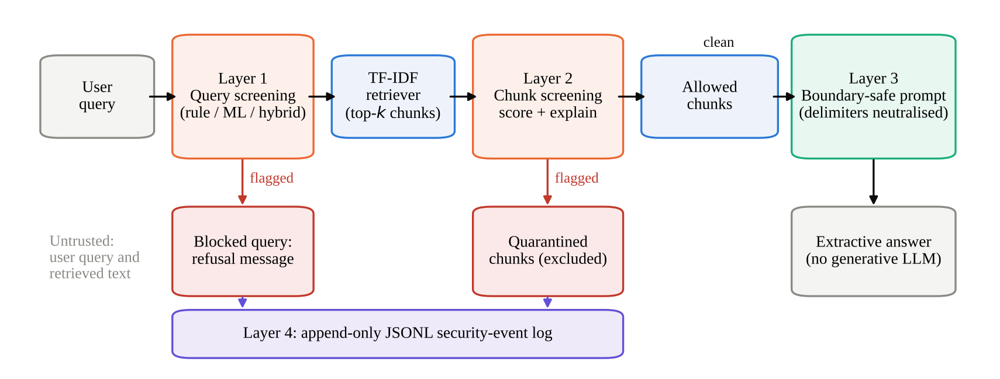
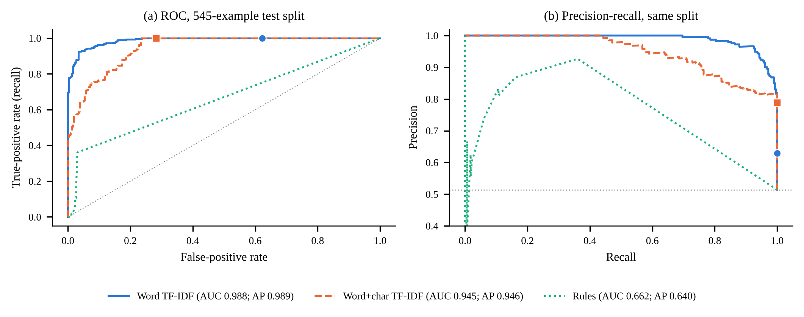
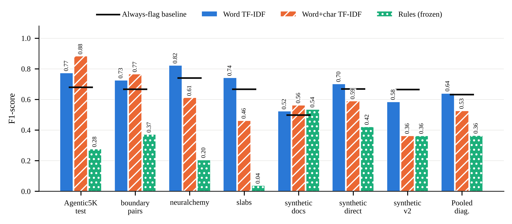
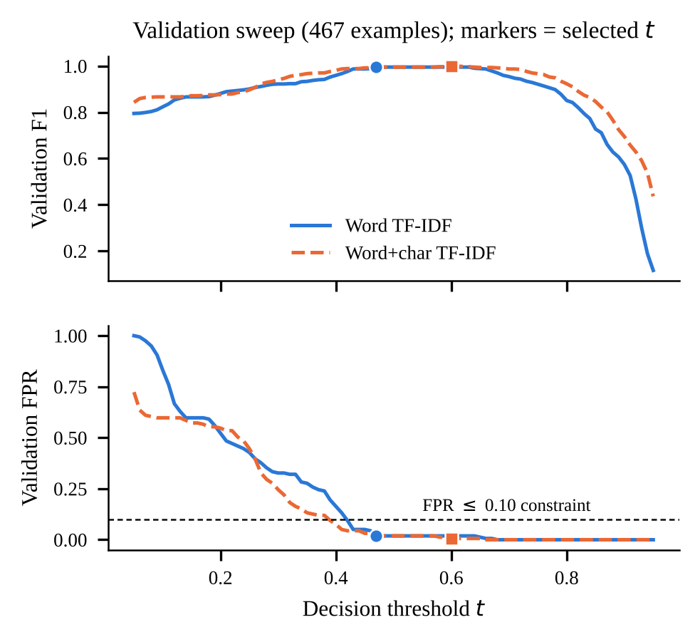
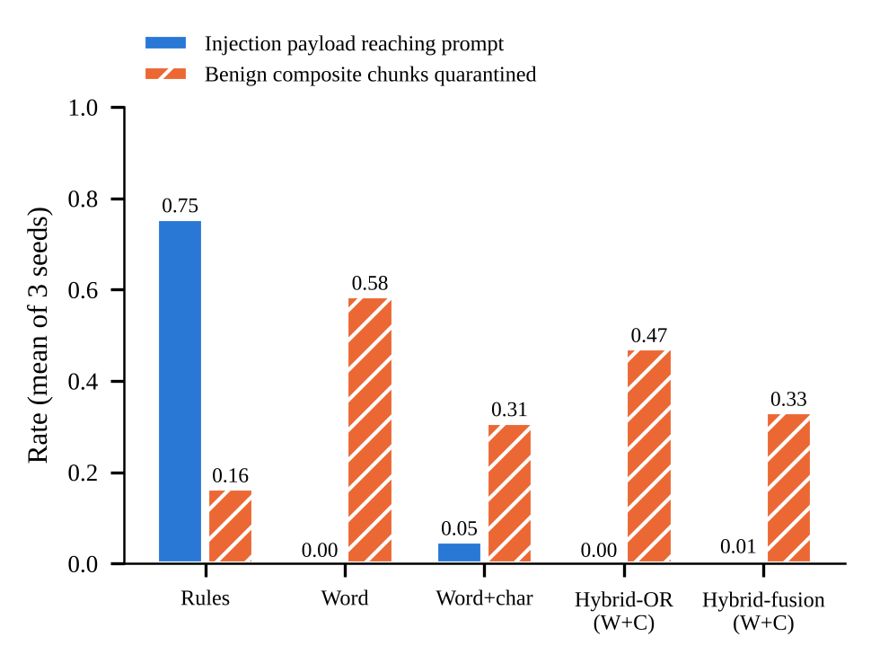

# Prompt-Injection Detection for Retrieval-Augmented Generation (RAG)

[](https://github.com/nadeem015/rag-prompt-injection-detection/actions/workflows/ci.yml)


A research prototype and reproducibility package. It studies how well lightweight detectors can catch **prompt-injection attacks hidden in the documents a RAG system retrieves**, for example a web page or PDF that says *"ignore your previous instructions and…"*. The detectors sit between the retriever and the prompt. They screen the user's query and every retrieved chunk, quarantine anything flagged, and wrap the rest in a boundary-protected prompt.

Companion code for the research paper *Prompt Injection Detection in Retrieval-Augmented Generation Systems: A Lexical-Baseline Study with Rule and Hybrid Screening and a Context-Screening Simulation* (M. A. Nadeem Ahmed).



## Headline results

Scenario-isolated test split of the primary dataset (545 examples, 280 injections), at validation-selected thresholds:

| Detector | F1 (95% bootstrap CI) | Recall | False-positive rate | ROC AUC | Median latency |
|---|---|---|---|---|---|
| Always flag (baseline) | 0.679 | 1.000 | 1.000 | — | — |
| Rules only (reconstructed) | 0.276 | 0.164 | **0.026** | 0.662 | **0.08 ms** |
| Word TF-IDF + LR | 0.772 (0.738–0.804) | 1.000 | 0.623 | **0.988** | 0.35 ms |
| **Word+char TF-IDF + LR** | **0.882 (0.854–0.908)** | 1.000 | 0.283 | 0.945 | 1.07 ms |
| Hybrid fusion (rules + word+char) | **0.882 (0.854–0.908)** | 1.000 | 0.283 | — | 1.21 ms |

What this shows:

- Character n-grams make the best operating point: every injection is caught, and benign false alarms drop from 62% to 28%.
- Word-only TF-IDF ranks examples better (higher AUC). Its weaker F1 comes from **threshold calibration**, not from weaker features.
- The rules are almost never wrong when they fire (2.6% FPR) but miss most attacks. Fusing them with the ML score adds nothing at this threshold.
- On six external diagnostic sets, pooled F1 falls to 0.53–0.64, close to the always-flag baseline. **Lexical detectors do not generalise across attack styles.** This is the paper's central caution.
- Every detector runs in about a millisecond per chunk on a CPU, so screening adds almost no latency to retrieval.

| | |
|---|---|
|  |  |
|  |  |

All numbers are recomputed from stored predictions by `experiments/run_final_analysis.py` and independently re-derived by `experiments/independent_verification.py` (768 values, 0 mismatches). Full tables are in `results/final/metrics/`.

## Scope and honesty notes

* The response stage is **extractive** (sentence selection). **No generative LLM is called anywhere.**
  The boundary-protected prompt is displayed but never sent to a model.
* The detectors are lexical research baselines. On the headline test they flag 28–62% of benign examples at the operating points used. **This is not a production security control.**
* Training of the two ML models is **not re-run** in this package (it needs Hugging Face access). The stored models in `results/final_experiment/` reproduce the stored probabilities to 2.2e-16.
* The **rule detector is a reconstruction** (`src/rules.py`, SHA-256 recorded in the manifests) because the original module was unavailable. All rule and hybrid results come from it.
* `experiments/run_final_experiment.py` is a *reconstruction* of the lost training script and has **never been executed**.

## Files not included in this repository

These files contain example **text from the third-party Hugging Face datasets**, so they are not redistributed here. Please check each dataset's licence.

- `results/final_experiment/all_test_predictions.csv`: per-example text, labels and stored model probabilities. It is the input to the analysis scripts.
- `results/final/predictions/headline_test_predictions_with_text.csv`

Everything derived from them (metrics, curves, statistical tests, ablations, figures and the text-free prediction table) **is** included. Without these files, the full test suite passes except one inference-reproducibility test, which is skipped automatically. The analysis scripts in section 4 need them.

## 1. Setup (Windows PowerShell, VS Code terminal)

```powershell
git clone https://github.com/nadeem015/rag-prompt-injection-detection
cd rag-prompt-injection-detection
py -3.13 -m venv .venv          # Python 3.11+ should work; 3.13 was used for the tests
.\.venv\Scripts\Activate.ps1
# If activation is blocked:  Set-ExecutionPolicy -Scope Process -ExecutionPolicy Bypass
python -m pip install --upgrade pip
python -m pip install -r requirements.txt
```

The stored models were pickled with scikit-learn 1.8.0. Newer versions load them with a warning (verified for 1.9.1).
For an exact match: `python -m pip install scikit-learn==1.8.0`.

## 2. Run the tests

```powershell
python -m pytest -q
```

## 3. Launch the app

```powershell
streamlit run app.py
```

Tabs: Dashboard, Knowledge base (upload / paste / remove documents), Query (retrieved context with per-chunk detection,
quarantined vs. allowed chunks, boundary-protected prompt), Event history (JSONL log), Evaluation (stored result tables and figures).
The sidebar offers the five detection modes and the top-k setting. Two synthetic documents prefixed `POISONED_DEMO_` contain planted
payloads so that quarantine can be demonstrated; untick the sidebar option to remove them.

Command-line use without the UI:

```powershell
python -c "from src.config import PipelineConfig; from src.ingest import load_directory; from src.pipeline import SecureRAGPipeline; p=SecureRAGPipeline(load_directory('data/knowledge_base')); r=p.run('What is the shipping policy?'); print(r.answer); print([q['source'] for q in r.quarantined])"
```

## 4. Reproduce the analysis (no retraining)

```powershell
python experiments/run_final_analysis.py              # metrics, ROC/PR, McNemar, bootstrap, ablations -> results/final/
python experiments/run_context_screening_simulation.py # payload-in-carrier exposure simulation
python experiments/run_extra_metrics.py                  # FNR, macro/weighted F1
python experiments/run_latency_benchmark.py              # CPU latency (timings vary by machine)
python experiments/make_figures.py                     # fig1..fig6 (png + pdf)
python experiments/independent_verification.py         # separate re-computation of 768 values (exit 1 on mismatch)
```

Per-experiment script, input, output and seed: `docs/experiment_provenance.md`.

`run_final_analysis.py` first re-derives all 106 originally reported metric values from the stored predictions
(maximum absolute difference 1.1e-16) and writes `results/final/metrics/verification_original_vs_recomputed.csv`.
Historical files in `results/final_experiment/` and `results/historical/` are never modified.

## 5. Detectors and configuration

| Mode | Decision rule |
|---|---|
| `rule` | frozen noisy-OR indicator score ≥ 0.50 (`src/rules.py`, SHA-256 in the manifests) |
| `word_tfidf` | LR probability ≥ 0.47 (validation-selected) |
| `word_char_tfidf` | LR probability ≥ 0.60 (validation-selected) |
| `hybrid_or` | rule flag **or** ML flag |
| `hybrid_fusion` | min(1, p + 0.10·[rule flag]) ≥ threshold |

Default configuration: `configs/default_config.json` (mirrors `src/config.py`). Overriding a threshold in the UI leaves the
validation-selected operating point; do not quote such runs as the paper's results.

## 6. Layout

```
app.py                      Streamlit UI
src/                        rules (reconstructed), ML detector, fusion, ingestion, retrieval, prompt builder, pipeline, event log
                            document_loader.py / rag_pipeline.py are thin aliases of ingest.py / pipeline.py
tests/                      53 tests (unit, integration, PDF ingestion, stub app smoke test, real Streamlit AppTest)
experiments/                analysis, simulation, figures, independent verification, (unexecuted) reconstructed training script
results/final_experiment/   HISTORICAL author results (read-only)
results/final/              outputs of the scripts above
data/                       demo knowledge base, demo queries
configs/                    default configuration
docs/                       methodology, provenance, verification, testing and review reports
```

## 7. Data and licences

The training/evaluation data are public Hugging Face datasets and are **not redistributed** here; only derived predictions and metrics are.
Check each dataset's licence before redistributing anything derived from it (see `docs/reference_verification_report.md`
for what could and could not be verified).

## 8. Known limitations

* Lexical models partly key on style (function words); hard-negative benign text is heavily over-flagged.
* Word-only TF-IDF has higher ROC AUC than word+char on the headline split; the F1 advantage of word+char reflects threshold calibration.
* Pooled external diagnostics are near the always-flag baseline for F1.
* The exposure simulation uses synthetic carriers and measures screening exposure, not downstream attack success.
